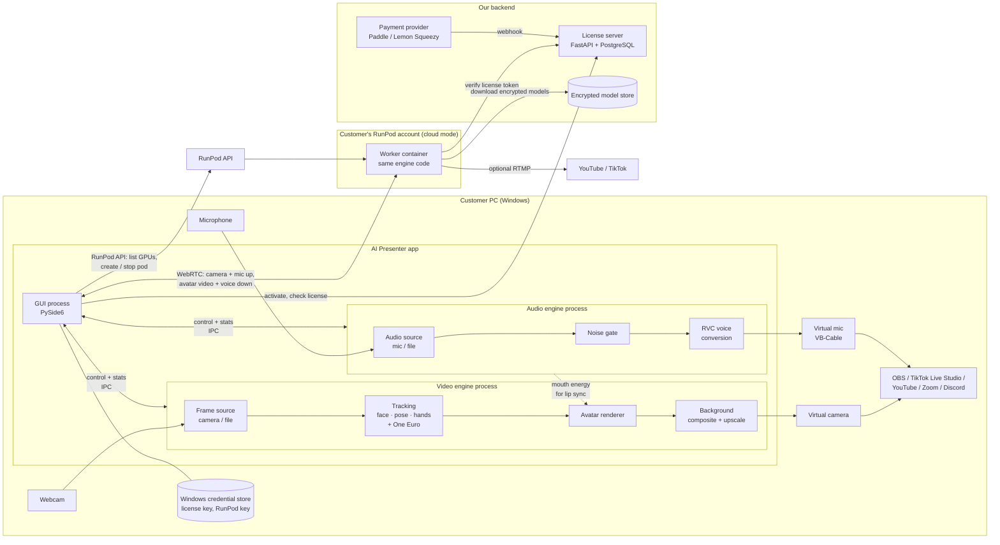
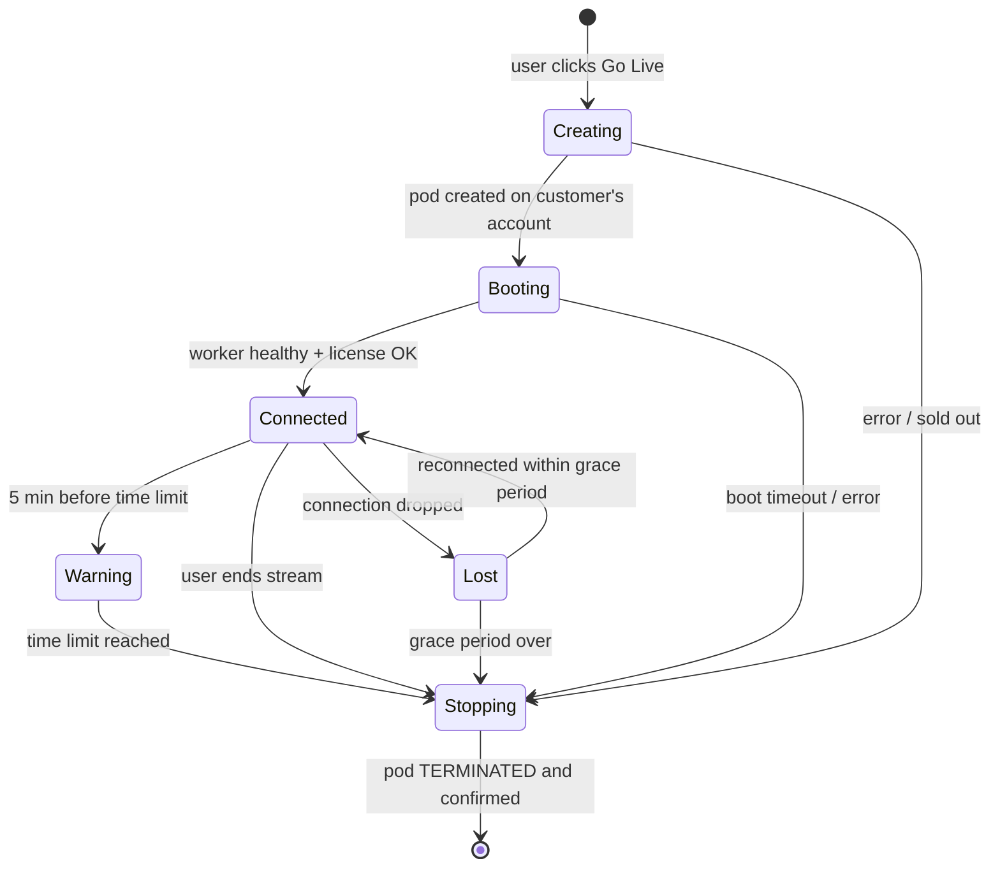

# Architecture

## 1. Big picture



## 2. Why separate processes

Real-time video and real-time audio need different things:

| | Video engine | Audio engine |
|---|---|---|
| Budget | 33 ms per frame (30 fps), < 200 ms total delay | 10–20 ms blocks, < 100 ms total delay |
| What hurts it | heavy GPU work, frame spikes | **any** pause makes the voice crackle |

Separate processes give each engine its own Python GIL and its own CUDA context. A slow avatar
frame can't make the voice stutter, and if one engine crashes the GUI restarts it and the stream
keeps going. The GUI only sends commands and receives stats and preview frames.

Data between processes:

- **Control and stats**: a small message bus (`multiprocessing` pipes, JSON-like messages).
- **Preview frames**: shared-memory ring buffer, so frames are not copied through pickle.
- **Lip-sync signal**: the audio engine publishes mouth openness / viseme energy at about 100 Hz.
  The avatar blends it with the tracked mouth so lips match the *converted* voice.

## 3. Video pipeline (per frame)

```
capture (CPU) → tracking (CPU / GPU) → One Euro smoothing → motion parameters
  → avatar model (GPU, FP16 / TensorRT) → matting + background composite (GPU)
  → upscale 512×768 → 1280×720 (GPU) → AI label → virtual camera
```

Rules that keep delay low:

- **Always use the newest frame.** If the renderer is slower than the camera, old frames are
  dropped and never queued, so delay can't build up over a 35-minute stream.
- Frames stay on the GPU from the avatar model to the final copy. There is exactly one
  GPU → CPU copy, for the virtual camera.
- Fixed-size buffers allocated at start. No memory growth (checked by a soak test).
- Every stage reports its timing with `common.timing`. `aip bench` prints them per component.

## 4. Audio pipeline (per block)

```
WASAPI input (48 kHz, 10–20 ms blocks) → noise gate → resample 16 kHz
  → ContentVec features + RMVPE/FCPE pitch → RVC generator (ONNX, GPU)
  → crossfade with the previous block → resample 48 kHz → WASAPI output (VB-Cable)
```

Latency budget: input buffer about 20 ms, processing about 40 ms, output buffer about 20 ms,
plus the context window. Target is under 100 ms.

## 5. Cloud mode

The worker container runs **the same `engine` package**. Only the input and output change:
frames and audio come from WebRTC instead of the webcam and mic, and results go back through
WebRTC (and/or RTMP directly to YouTube/TikTok).

Pod lifecycle, owned by `cloud/` in the app:



**Rule: every path ends in "pod terminated and confirmed".** The app also stops the pod when it
starts up and finds one left over from a crash. The worker has its own deadline timer as a
second safety net, so the pod shuts itself down even if the app is gone.

## 6. Security

- Customer RunPod keys and license keys: Windows DPAPI via `keyring`. They are never written to
  config or logs (log redaction filter) and never sent to our server.
- Models: AES-256-GCM encrypted at rest. The key is released by the license server after a
  valid check and kept only in memory. The worker never writes decrypted weights to disk.
- License check at every stream start. A short offline grace period covers network hiccups.

## 7. Packages and dependencies

```
common  ←  engine  ←  worker
   ↑         ↑
   └──── app ┘ ──→ cloud
license_server  (separate deployable; only shares common)
training        (uses engine models; runs on GPU boxes)
```

`engine` never imports `app` or Qt, so it runs headless in the cloud worker.
